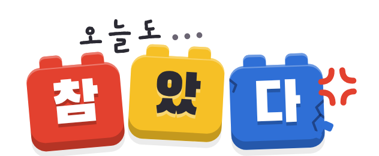

<p align="center"></p>

# 오늘도 참았다

회사에선 못 하는 것, 여기선 마음껏. 폰의 모션 센서로 회사 스트레스를 푸는 브릭 스타일 미니 게임. 빌드 없이 동작하는 단일 HTML(`index.html`)입니다.

| 방 | 모션 | 터치 대체 |
|---|---|---|
| 🟥 결재 반려하기 | 폰을 도장처럼 쾅! 내려찍기 → 상사가 올린 결재 반려 | 서류 탭 |
| 🟦 업무 파쇄기 | 폰을 마구 흔들면 파쇄기 터보 → 업무 자동 파쇄 | 종이 아래로 쓸기·탭, 파쇄기 연타 |
| 🟪 사직서 던지기 | 공 던지듯 앞으로 휙! → 파워에 따라 툭/착!/쾅!! | 사직서를 위로 플릭 |

- 한 판 40초. 끝나면 "오늘의 스트레스는 00%나 되었군요."와 위로의 말, 기록은 스트레스 캘린더에 쌓입니다.
- 상사 이름·기록은 그 폰의 브라우저(localStorage)에만 저장됩니다.
- 홈 화면에 추가하면 앱처럼 열립니다 (아이콘 포함).
- 아이폰은 '시작하기'를 누를 때 동작 및 방향 권한을 묻습니다 (HTTPS 필수).
- 테스트용: 주소 뒤에 `?t=8` → 한 판 8초.

## 배포 (GitHub Pages)

Settings → Pages → Build and deployment → **Deploy from a branch** → `main` / `(root)` → Save.
1~2분 뒤 `https://<아이디>.github.io/<저장소이름>/` 에서 열립니다.

## 로컬 실행

```bash
python3 -m http.server 8000   # http://localhost:8000
```

## 📊 운영 대시보드 (익명 이용 통계)

- 대시보드: `/dashboard/` (비밀번호로 잠김) · 예시 데이터 미리보기: `/dashboard/?demo`
- 저장소: Supabase(무료). `analytics/setup.sql` 을 SQL Editor 에서 한 번 실행하고, `analytics-config.js` 에 Project URL 과 공개 키를 넣으면 수집이 시작됩니다.
- 수집 항목: 익명 방문자 ID(무작위), 방문·이용 시간, 게임 시작/완료/중도 포기, 스트레스 %, 버튼 클릭, 기기, 유입 경로.
  상사 이름과 직접 쓴 내용은 수집하지 않습니다. 로컬(localhost) 테스트와 '추적 안 함' 설정 브라우저는 집계에서 빠집니다.

